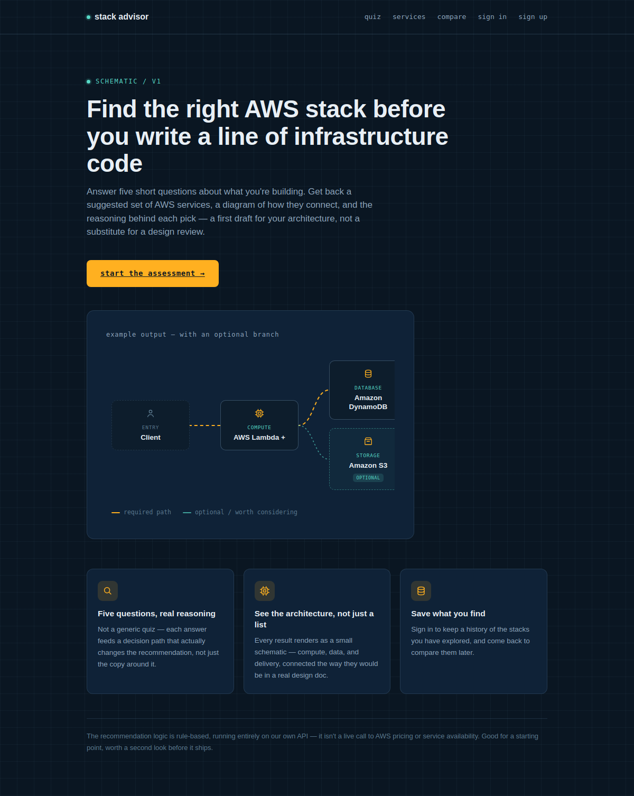
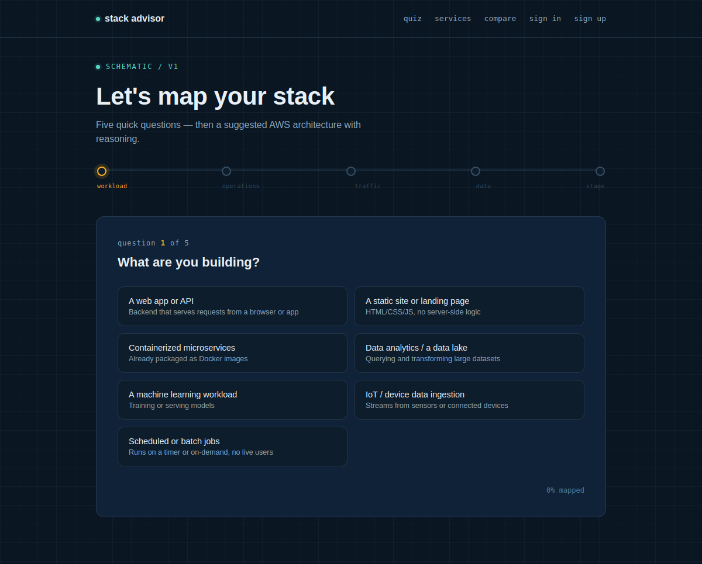
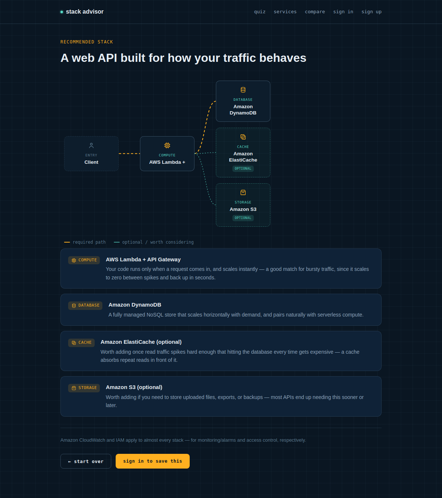
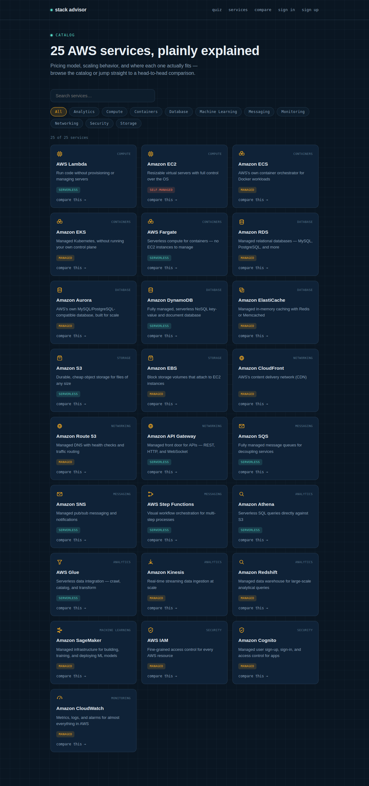
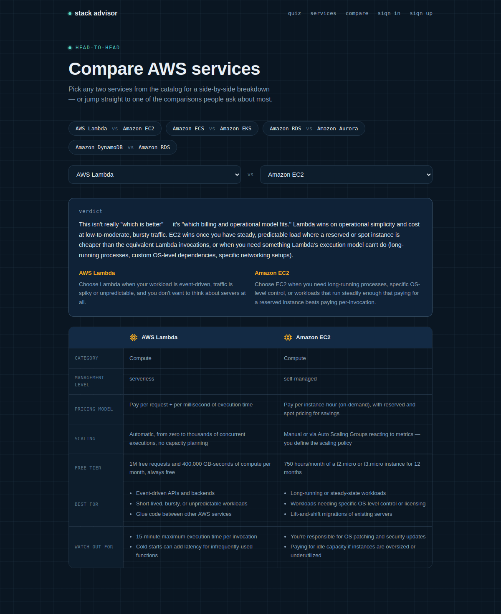

# Stack Advisor

A MERN-stack app that recommends an AWS architecture from a five-question
quiz, renders it as a real branching diagram, and lets you compare any two
of 25 catalogued AWS services head-to-head.

[](https://github.com/DeeptiBaghel-hub/AWS-Stack-advisor2/actions/workflows/ci.yml)

**[Live demo →](#)** &nbsp;·&nbsp; _add your deployed URL here — see [DEPLOYMENT.md](./DEPLOYMENT.md)_



## Why this exists

Most portfolio projects answer "can you build CRUD." This one is closer to
what the job actually looks like: taking a fuzzy set of requirements,
reasoning through real tradeoffs (Lambda vs EC2, RDS vs DynamoDB), and
representing that reasoning as both structured data and a diagram a
reviewer could actually use. It's a rules-based recommendation engine today,
not a call to AWS's pricing API — that limitation is intentional and stated
up front rather than hidden.

## Screenshots

| | |
|---|---|
|  |  |
| Five-question wizard with a circuit-trace progress indicator | Real branching diagram — a compute node fanning out to a database and optional cache/storage, not a straight line |
|  |  |
| 25 services, searchable and filterable by category | Any two services, diffed side by side, with curated verdicts for the classic matchups |

## Stack

- **MongoDB** — user accounts, saved recommendations, and the 25-service catalog (Mongoose)
- **Express** — REST API: auth (JWT), recommendations, and the service/compare endpoints
- **React** — Vite-powered SPA, React Router, a small hand-built design system (no UI kit)
- **Node.js** — runs the Express server

## Features

- A landing page structured around three equal-weight entry points (quiz,
  catalog, compare) rather than funneling everyone through the quiz —
  personalized for signed-in users with a saved-stack count and a link
  straight to history
- Interactive quiz with a progress tracker, backed by a rule-based
  recommendation engine (workload type, ops preference, traffic pattern,
  database need, project stage → a suggested stack with reasoning per service)
- A staged "building your stack" loading sequence between the last question
  and the result, so the recommendation reads as reasoned rather than instant
- **Real branching architecture diagrams** — the recommendation engine outputs
  a node/edge graph, not a flat chain, so a compute node can fan out to a
  database, an optional cache, and optional storage all at once. The frontend
  does actual topological layout and draws SVG connectors between measured
  DOM positions, not hardcoded lines
- **A 25-service catalog**, browsable and searchable by category, backed by
  MongoDB (`npm run seed` populates it)
- **A Compare page** — pick any two services for a generated attribute
  diff (pricing model, scaling, management level, best-for, watch-outs), plus
  hand-written verdicts for the four comparisons people actually search for
  (Lambda vs EC2, ECS vs EKS, RDS vs Aurora, DynamoDB vs RDS)
- Original, custom-drawn icons per service category — not AWS's own icon
  set, which is trademarked
- Email/password auth with hashed passwords (bcrypt) and JWT sessions
- Signed-in users can save, view, and delete past recommendations
- **An AI chat assistant** ("why ECS over EKS?", "how much would this cost?"),
  grounded in the app's own service catalog and curated comparisons so its
  answers stay consistent with what the rest of the app shows. Runs on
  Google's Gemini API — the one major LLM provider with a free tier that
  needs no credit card, which matters for a project meant to stay live
  without an ongoing bill
- **Free-text project intake** — describe what you're building in a
  sentence ("a food delivery app with 50k users, image uploads, Postgres,
  and low cost") instead of clicking through the quiz. The AI's job stops at
  extracting the same five structured parameters the quiz collects; it
  never invents services or a diagram directly, so the result runs through
  the exact same tested recommendation engine either way. The extracted
  answers are always shown back to you before the recommendation, with a
  one-click way to switch to the manual quiz if it misunderstood
- Input validation and centralized error handling on the API
- **Toast notifications** on sign-in, sign-up, save, delete, and PDF export
- **PDF export** of any recommendation — a real generated report (title,
  architecture as readable text, service reasoning, footnotes), not a
  pixel-snapshot of the page. Loaded via dynamic import, so the ~390KB PDF
  library only downloads for people who actually click the button, not on
  every page load
- **JSON export** alongside PDF, for anyone who wants the structured data
  instead of a formatted report. Deliberately strips Mongo-internal fields
  (`_id`, `user`, `shareId`, raw `answers`) when exporting a saved history
  item — the point is a clean, portable representation of the
  recommendation itself, not a raw database dump
- **Dark/light mode**, persisted across sessions and respecting OS
  preference on first visit. Every color pair in the light theme was
  checked against WCAG AA contrast with an actual script, not eyeballed —
  two of the first-pass values initially failed and needed darkening
- **A profile page** — edit your display name, change your password
  (requires the current one), see when you joined and how many stacks
  you've saved
- **A dashboard** (`/dashboard`) for signed-in users — real aggregated
  stats computed from your own saved recommendations, not decorative
  numbers: total saved stacks, your average Well-Architected score across
  all of them (per pillar, not just the overall number), which workload
  types you've explored most, and a quick view of recent activity. Adds no
  new backend endpoint — it's a different view over the same data the
  History page already fetches, so the numbers can't drift out of sync
  with what History actually shows
- **A cost estimator** with sliders (users/day, actions/user, storage,
  data transfer) that recomputes instantly — entirely client-side static
  math against approximate list prices, not a live AWS Pricing API call.
  That's deliberate: it's free to run and works offline, at the cost of
  being illustrative rather than a real quote, and it says so on the page.
- **A Well-Architected review** — every recommendation is scored against
  AWS's actual, published 6-pillar framework (Operational Excellence,
  Security, Reliability, Performance Efficiency, Cost Optimization,
  Sustainability), rule-based and grounded in the specific quiz answers, not
  an invented "readiness score." Spiky traffic on serverless compute scores
  differently than the same traffic on manually-scaled EC2, because the
  framework actually treats those differently.
- **Shareable read-only links** for any saved recommendation — a public
  `/shared/:id` page, no login required to view, that never exposes the
  owning user's identity or raw quiz answers, only the recommendation itself
- **Compare two saved recommendations head-to-head** (`/history/compare`)
  — select any two from your history and get a real quantitative
  comparison: which one wins each of the 6 Well-Architected pillars, an
  overall verdict, and a service diff (what's shared between both stacks
  vs. unique to each). Ties together two features that otherwise don't
  talk to each other — Compare (service vs. service) only ever handled
  the catalog, never someone's own saved results
- **A "how it works" page** (`/how-it-works`) — the app's own architecture,
  rendered with the same diagram engine built for AWS recommendations.
  No special-casing: if the engine can lay out a real branching graph for
  a quiz result, it lays out this one the same way. Paired with reasoning
  cards (reusing the same component used for AWS service recommendations)
  explaining the actual design decisions behind this project, not a
  generic feature list
- **"Duplicate & tweak" a saved stack** — from any saved recommendation,
  jump back into the quiz with those exact same answers already selected,
  change just the dimension you're curious about, and see how the
  recommendation shifts. Both results are then directly comparable through
  the history comparison feature, so "what if I'd said spiky instead of
  steady" gets a concrete, quantified answer instead of a guess
- **Terraform scaffold generation** (`/terraform`) — the highest-risk
  feature in this app, treated accordingly. Template-based, never
  AI-generated: every resource block comes from a hand-written, reviewed
  template for that specific service, and complex or high-risk services
  (EKS, Redshift, SageMaker, Kinesis, Glue, Athena, Step Functions, IoT
  Core, Batch) are explicitly declined rather than templated badly.
  Security defaults are conservative on purpose — S3 buckets block all
  public access, RDS is never publicly accessible, database passwords and
  SSH CIDRs are required variables with no default (so nothing accidentally
  ships open), and IAM roles get only the minimum managed policy needed to
  function. Download buttons stay disabled until you check a box
  acknowledging this needs review before applying — the UI itself won't
  let you skip that step
- **An accessibility pass beyond color contrast**: a screen-reader text
  alternative for the diagram (it's otherwise an SVG of curved paths, which
  says nothing useful to assistive tech), keyboard focus management and
  Escape-to-close on the chat widget, accessible names on the compare
  page's service pickers, and a consistent keyboard focus ring across every
  interactive element instead of relying on inconsistent browser defaults
  Works from a recommendation's actual services (linked from results) or
  from a generic preset if you land on it directly
- Security hardening: `helmet` HTTP headers, rate limiting scoped to the
  actual brute-force-sensitive endpoints (login/register), and every async
  route wrapped so a database error returns a clean 500 instead of
  crashing the whole process
- Session expiry is handled globally: the auth middleware tags a
  missing/invalid/expired-token rejection with `code: 'AUTH_REQUIRED'`, and a
  client-side axios interceptor reacts to that code (not to any 401) by
  clearing the stale session, showing a toast, and redirecting to login.
  Keying off the code matters — a wrong login password or a wrong "current
  password" on the profile page are also 401s, and must just show an inline
  error rather than sign you out. Both directions have E2E tests.
- **Observability**: structured JSON logs (pino) with a correlation id on
  every request — carried in the `X-Request-Id` response header and in any
  error's JSON body, so a user-reported error can actually be traced back
  to one line in the logs instead of guessed at. Error tracking via Sentry
  (free tier, no credit card) on both server and client, genuinely optional
  — with no `SENTRY_DSN`/`VITE_SENTRY_DSN` configured, it's a complete
  no-op, not a degraded mode. The client also has a top-level error
  boundary, which closed a real, previously-existing gap: before this,
  an uncaught render error anywhere would white-screen the whole app with
  no fallback
- Three test layers: unit tests for pure logic on both the server
  (`server`: `npm test`) and client (`client`: `npm test` — the Terraform
  generator's security invariants specifically), integration tests
  exercising real HTTP requests against the actual Express app with an
  in-memory MongoDB (`server`: `npm run test:integration`), and Playwright
  E2E tests driving a real browser against the real client and API
  (`e2e/`) — 72 tests covering the full
  auth/quiz/history/share/describe/dashboard/compare/tweak/terraform
  flows, including things only a browser-level test catches, like a
  password change actually working when you log back in with it afterward
## Project structure

```
aws-stack-advisor/
├── server/                     Express API
│   ├── src/
│   │   ├── config/db.js        Mongo connection
│   │   ├── models/             User, Recommendation, Service (Mongoose schemas)
│   │   ├── data/
│   │   │   ├── serviceCatalog.js   25 AWS services (seed data)
│   │   │   └── comparisons.js      Curated verdicts for classic matchups
│   │   ├── scripts/seed.js     Upserts the catalog into MongoDB
│   │   ├── controllers/        auth, recommend, and service request handlers
│   │   ├── routes/             /api/auth, /api/recommend, /api/services
│   │   ├── middleware/         JWT auth guard, validation, error handling
│   │   ├── utils/
│   │   │   ├── recommendationEngine.js       pure recommendation logic
│   │   │   └── recommendationEngine.test.js  unit tests
│   │   └── index.js            app entry point
│   ├── .env.example
│   └── package.json
├── client/                     React (Vite) frontend
│   ├── src/
│   │   ├── api/axios.js        API client, attaches JWT from localStorage
│   │   ├── context/AuthContext.jsx
│   │   ├── components/         Navbar, Stepper, Diagram, WhyCard, Icon,
│   │   │                       LoadingSequence, ProtectedRoute
│   │   ├── pages/               Landing, Quiz, Results, Services, Compare,
│   │   │                       Login, Register, History
│   │   └── questions.js        Quiz question bank shared by the wizard
│   ├── .env.example
│   └── package.json
├── e2e/                         Playwright end-to-end browser tests
├── docs/screenshots/           Images used in this README
├── .github/workflows/ci.yml    CI: tests + build on every push
├── render.yaml                 Render Blueprint for the API
└── DEPLOYMENT.md               Step-by-step guide to a live deployment
```

## Running it locally

You'll need Node.js 18+ and a MongoDB connection string (a free
[MongoDB Atlas](https://www.mongodb.com/atlas) cluster works fine, or a local
`mongod`).

**1. Start the API**

```bash
cd server
cp .env.example .env     # then fill in MONGO_URI and JWT_SECRET
npm install
npm run seed              # populates the 25-service catalog (safe to re-run)
npm run dev                # http://localhost:5000
```

The chat assistant needs a `GEMINI_API_KEY` in `.env` to work — get a free one
at [aistudio.google.com/apikey](https://aistudio.google.com/apikey) (no
credit card required for the free tier as of this writing; the rest of the
app works fine without it, the chat widget just returns a clear error until
it's set).

**2. Start the frontend**

```bash
cd client
cp .env.example .env     # defaults to http://localhost:5000/api, adjust if needed
npm install
npm run dev               # http://localhost:5173
```

Open `http://localhost:5173`. The quiz and catalog/compare pages work without
an account; sign up to save quiz results to your history.

**3. Run the backend tests**

```bash
cd server
npm test                # unit tests — pure logic, no DB needed
npm run test:integration  # integration tests — real HTTP requests + in-memory MongoDB
npm run test:all          # both
```

**4. Run the end-to-end tests**

Drives a real browser against the real client and API — see
[`e2e/README.md`](./e2e/README.md) for details.

```bash
cd e2e
npm install
npx playwright install chromium
E2E_MONGO_URI="<your MongoDB connection string>" npm test
```

## API reference

| Method | Path                       | Auth | Description                          |
|--------|----------------------------|------|---------------------------------------|
| POST   | `/api/auth/register`       | —    | Create an account, returns a JWT      |
| POST   | `/api/auth/login`          | —    | Sign in, returns a JWT                |
| GET    | `/api/auth/me`             | ✔    | Current user                          |
| PUT    | `/api/auth/profile`        | ✔    | Update name and/or password           |
| POST   | `/api/recommend`           | —    | `{ answers }` → recommended stack     |
| POST   | `/api/recommend/from-description` | — | `{ description }` → AI-extracted answers + recommended stack |
| POST   | `/api/recommend/history`   | ✔    | Save a recommendation                 |
| GET    | `/api/recommend/history`   | ✔    | List your saved recommendations       |
| DELETE | `/api/recommend/history/:id` | ✔ | Delete a saved recommendation         |
| GET    | `/api/recommend/shared/:shareId` | — | Public, read-only view of a saved recommendation |
| GET    | `/api/services`            | —    | List catalog services (`?category=`, `?q=`) |
| GET    | `/api/services/categories` | —    | List distinct categories              |
| GET    | `/api/services/:slug`      | —    | Single service detail                 |
| GET    | `/api/services/compare?a=&b=` | — | Compare two services by slug          |
| GET    | `/api/services/compare/featured` | — | The curated comparison pairs       |
| POST   | `/api/assistant/chat`      | —    | `{ messages, recommendationContext? }` → assistant reply |

## Deploying

Full walkthrough in [DEPLOYMENT.md](./DEPLOYMENT.md). Short version:

- **Database**: MongoDB Atlas free tier
- **API**: Render (a `render.yaml` Blueprint is included) — set `MONGO_URI`,
  `JWT_SECRET`, and `CLIENT_ORIGIN`
- **Frontend**: Vercel or Netlify — build command `npm run build`, output
  directory `dist` (a `vercel.json` and `_redirects` are included so
  client-side routes like `/services` don't 404 on refresh). Set `VITE_API_URL`
  to your deployed API's `/api` URL

## Honest limitations

Worth knowing, and worth saying out loud in an interview if asked:

- The recommendation engine is rule-based, not a live call to AWS pricing or
  service availability. It's a reasoned starting point for an architecture
  discussion, not a definitive answer.
- Only 4 of the 300 possible service-pair comparisons have a hand-written
  verdict; the rest fall back to the generated attribute diff, which is
  accurate but less opinionated.
- The chat assistant's cost estimates are illustrative, not live AWS
  pricing — it's told explicitly to caveat this in its own answers. It's also
  rate-limited per IP (15 messages / 15 min) since every message costs real
  API quota shared across all visitors, on one API key.
- CI runs unit tests, integration tests, an E2E browser suite (Playwright,
  against a real MongoDB service container), and the client build on every
  push (see `.github/workflows/ci.yml`). The E2E suite skips the one test
  that costs a real Gemini API call unless `E2E_HAS_GEMINI_KEY` and a real
  key are both configured — everything else runs unconditionally.
- The accessibility pass covers keyboard navigation, focus management, and
  screen-reader alternatives for the diagram and other non-text UI — it
  hasn't been tested with an actual screen reader (VoiceOver/NVDA), only
  verified programmatically (ARIA roles, labels, focus order). Real
  assistive-tech testing would likely surface things automated checks miss.
- Free-text intake can only ever be as good as the five parameters it maps
  to — a wildly out-of-scope description (or one the model summarizes
  ambiguously) falls back to safe defaults rather than a wrong-but-confident
  guess, but that means unusual projects may need the manual quiz for an
  accurate result. The extracted answers are always shown before the
  recommendation specifically so this is easy to catch and correct.
- The Terraform generator only covers a curated subset of services with
  hand-written templates (Lambda, API Gateway, EC2, ECS/Fargate, RDS,
  Aurora, DynamoDB, S3, CloudFront, ElastiCache, SQS/SNS) — anything else
  is explicitly declined, not templated badly. Even the supported
  templates are a starting point, not a production deployment: no VPC
  design, no least-privilege IAM beyond the bare minimum, no monitoring.
  I also couldn't run a real `terraform validate` against the generated
  HCL in the environment this was built in (no network access to
  Terraform's own release channel) — the syntax is written against
  well-established, stable AWS provider patterns and checked
  structurally (balanced braces, no leaked template artifacts, correct
  variable wiring), but running `terraform validate` yourself before
  trusting it is still worth doing.
- React Router was upgraded from v6 (fully end-of-life, no security
  patches at all) to v7.18.3, which resolved two real CVEs (an open-redirect
  and an arbitrary-constructor-injection vulnerability) — not just a
  version-churn cleanup. Since this app only ever used declarative-mode
  routing (`BrowserRouter`/`Routes`/`Route`, no data routers, no relative
  paths anywhere), the upgrade needed no code changes beyond the version
  bump itself, verified by running the full 65-test E2E suite afterward
  since routing touches literally every page.
- `npm audit` on the client still flags one separate, unrelated issue: a
  moderate vulnerability in esbuild, used internally by Vite's dev server.
  It only affects local development (a malicious website could talk to
  your dev server while it's running), not the production build output,
  and fixing it needs a Vite major-version bump (v5 → v8) — a separate,
  bigger piece of work than the React Router upgrade, deferred rather than
  rushed into the same change.
- Sentry's free tier has real volume limits (error count per month) — this
  is genuine error tracking for a portfolio-scale project, not a substitute
  for a paid APM tool at real production traffic.

## License

MIT — see [LICENSE](./LICENSE).
